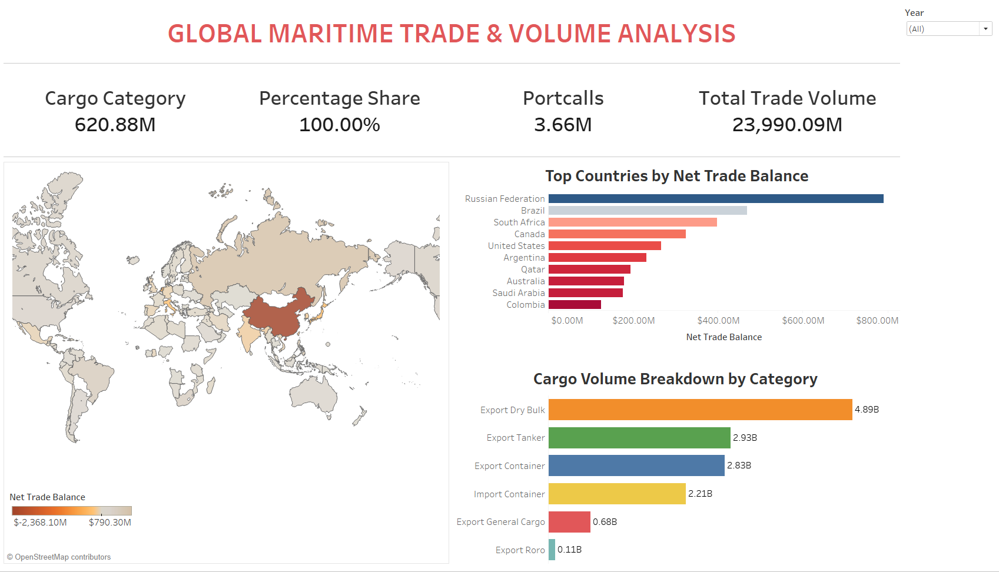
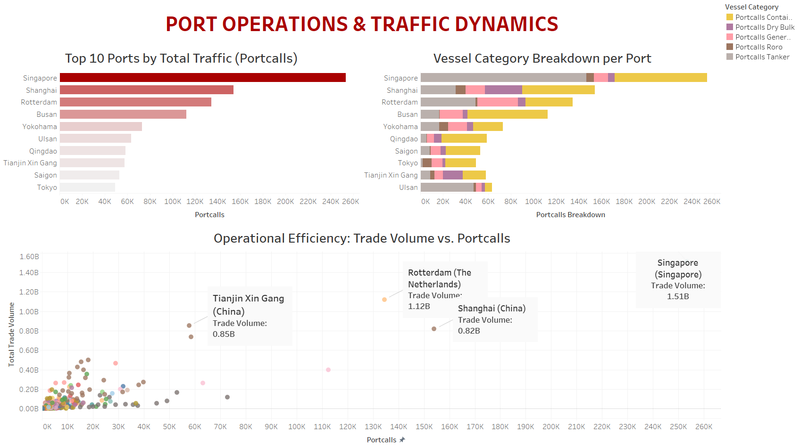
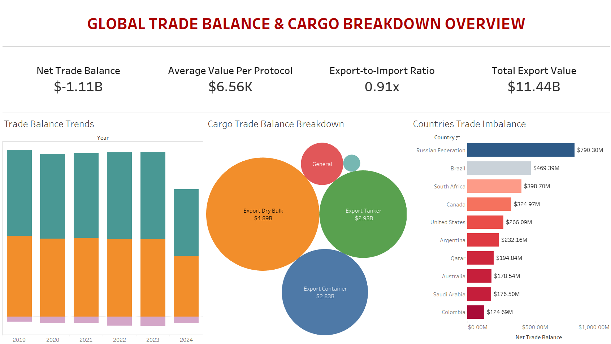

# Power BI & Tableau Data Analytics Portfolio | Nyjin Abraham

This repository contains three end-to-end Power BI projects focused on sales performance, customer analytics, financial volatility, and operational insights. All solutions leverage Star Schema data modeling, custom DAX metrics, structured data pipelines, and interactive visuals designed for business decision-making.

---

## Project 1: Hydraulic Sales Analysis

* Data Source & Stack: 230,000+ sales records queried and structured using SQL (Oracle DB).
* Key Features: Row-Level Security (RLS), What-If parameters, automated refreshes, custom visual tooltips, and hidden drill-through pages.
* Core Insight: Revealed heavy product concentration risk, with DC Valves driving over 86% ($202B+) of total sales revenue.

  

  

---

## Project 2: RetailMart Sales & Profitability Analysis

* Data Source & Stack: 73,000+ transactional records imported and transformed from Excel.
* Key Features: External weather tracking, target gauges, waterfall profit distribution, and competitor price benchmarking.
* Core Insight: Analyzed weather patterns against regional sales to help optimize seasonal inventory allocation.

  

  

---

## Project 3: Bitcoin Executive & Technical Trends Analysis

* Data Source & Stack: Python (Pandas) for ETL & time-series processing on 1,000,000+ data points -> Power BI.
* Key Features: Multi-page reporting (Executive vs Technical), rolling moving averages, max drawdown %, ATH drop tracking, daily volatility %, and custom volume heatmaps.
* Core Insight: Evaluated key price volatility and historical drawdown trends relative to peak highs across major market cycles.

  

---

## 🚢 Global Maritime Trade & Volume Analysis (Tableau Suite)

An enterprise-grade, 3-dashboard Tableau analytics suite powered by an *Oracle SQL* database engine handling *1,000,000+ transactional records*. Designed for executive storytelling, operational benchmarking, and financial trade balance evaluation.

### 🛠️ Data Architecture & Tech Stack
* *Database Engine:* Oracle SQL Database (Custom Views & Star Schema)
* *Dataset Size:* 1,000,000+ Transactional Rows
* *BI Tool:* Tableau Desktop (Packaged Workbook .twbx)

---

### 📊 Portfolio Dashboards

#### 1. Executive Macro Trade & Volume Overview

#### 2. Port Operations & Traffic Dynamics

#### 3. Global Trade Balance & Cargo Breakdown

---

### 💡 Key Technical & Business Insights
* *Operational Hub Efficiency:* Major maritime hubs like Singapore and Rotterdam drive disproportionate trade volumes relative to port call volume, exhibiting superior operational throughput.
* *Cargo Distribution:* Export Dry Bulk and Export Tanker categories represent over 60% of total cargo volumes globally.
* *Trade Imbalance:* Identifies top net surplus and deficit nations to guide strategic shipping routing and tariff evaluations.

## Tech Stack & Skills

* *Database & Processing:* Oracle SQL Database, SQL Server, Python (Pandas), Power Query (ETL)
* *BI & Dashboards:* Tableau Desktop, Power BI Desktop, Power BI Service, Microsoft Excel
* *Data Modeling & Architecture:* Star Schema Modeling, DAX Measures, Time-Series Analysis, Custom SQL Views, Packaged Workbooks (.twbx)
* *Security & Automation:* Row-Level Security (RLS), On-Premises Gateway Mapping, Scheduled Cloud Refreshes
